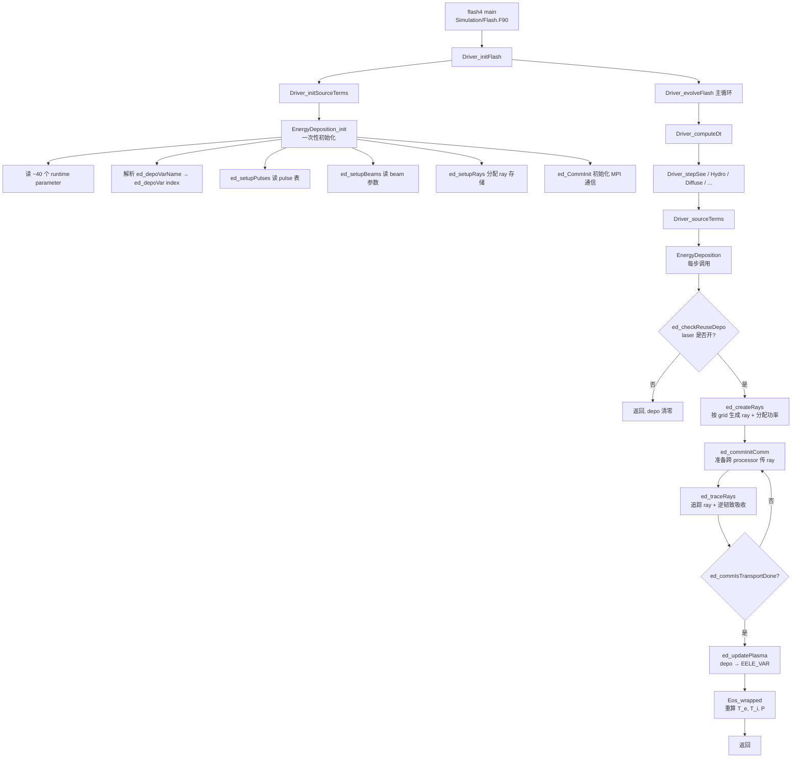

# 激光单元内部调用图

> **TL;DR**：激光单元分两阶段执行。**初始化阶段**（`EnergyDeposition_init`）一次性读所有 runtime parameter、解析变量名、设置常数、调用 `ed_setupPulses/Beams/Rays` 构造内部数据结构。**每步阶段**（`EnergyDeposition`）检查激光是否开 → 创建 ray → 追踪 ray → 沉积到 `EELE_VAR` → 调用 `Eos_wrapped` 重算温度。

---

## 1. 物理原理

> 详见 [[knowledge/overview]]。本条目只讲源码层面的实现机制，物理原理不重复。

---

## 2. 顶层调用关系

### 2.1 谁调用了激光单元

激光单元作为 sourceTerm 被 Driver 调用，**两个入口**：

| 入口 | 何时调用 | 调用者 | 源码 |
|---|---|---|---|
| `EnergyDeposition_init` | 程序启动一次（flash4 开始时） | `Driver_initSourceTerms` | `Driver/DriverMain/Driver_initSourceTerms.F90:37` |
| `EnergyDeposition` | 每个时间步一次 | `Driver_sourceTerms` | `Driver/DriverMain/Driver_sourceTerms.F90:56,68` |

**Driver_sourceTerms 调用顺序**（`Driver/DriverMain/Driver_sourceTerms.F90:44-69`）：

```fortran
#ifdef DRIVER_EDEARLY
  call EnergyDeposition(...)   ! 排在最前
#endif
  call Polytrope / Stir / Turb_calc / Flame_step / Burn / Heat
  call Heatexchange / Cool / Ionize
#ifndef DRIVER_EDEARLY
  call EnergyDeposition(...)   ! 默认：排在中后段
#endif
  call Deleptonize
```

→ 默认激光在 `Heatexchange/Cool` 之后被调用，对 3T 模型更稳。

### 2.2 主流程 mermaid 图



---

## 3. 初始化阶段详解（`EnergyDeposition_init.F90`）

**源码**：`source/physics/sourceTerms/EnergyDeposition/EnergyDepositionMain/Laser/EnergyDeposition_init.F90:79-449`

### 3.1 步骤序列

```fortran
! EnergyDeposition_init.F90 关键调用序列
call RuntimeParameters_get ("useEnergyDeposition", ed_useEnergyDeposition)  ! :79
if (.not. ed_useEnergyDeposition) return                                    ! :81  早退

! --- 读取 MPI 通信器 ---
call Driver_getMype (GLOBAL_COMM, ed_globalMe)                              ! :87
call Driver_getComm (GLOBAL_COMM, ed_globalComm)                            ! :88
call Driver_getMype (MESH_COMM, ed_meshMe)                                  ! :90
call Driver_getComm (MESH_COMM, ed_meshComm)                                ! :91

! --- 读取 ~40 个全局 runtime parameter ---
call RuntimeParameters_get ("basenm", ed_baseName)                          ! :94
call RuntimeParameters_get ("ed_gradOrder", ed_gradOrder)                   ! :117
call RuntimeParameters_get ("ed_laser3Din2D", ed_laser3Din2D)               ! :118
! ... (其他 36 个参数) ...

! --- 解析变量名 → 整数索引 ---
call RuntimeParameters_get ("ed_depoVarName", ed_depoVarName)               ! :144
call Simulation_mapStrToInt (ed_depoVarName, ed_depoVar, MAPBLOCK_UNK)      ! :146
call Simulation_getVarnameType (ed_depoVar, depoVarType)                    ! :154
ed_depoVarIsPerMass = (depoVarType .NE. VARTYPE_PER_VOLUME)                ! :158

! --- 设置 guard cell mask ---
allocate (ed_gcMask(NUNK_VARS)); ed_gcMask = .FALSE.                       ! :172-174
ed_gcMask(TELE_VAR) = .TRUE.                                                ! :176
ed_gcMask(NELE_VAR) = .TRUE.                                                ! :179
ed_gcMask(SUMY_MSCALAR) = .TRUE.                                            ! :182
ed_gcMask(YE_MSCALAR) = .TRUE.                                              ! :185

! --- 获取物理常数 ---
call PhysicalConstants_get ("speed of light", ed_speedOfLight)              ! :202
call PhysicalConstants_get ("electron charge", ed_electronCharge)           ! :203
call PhysicalConstants_get ("electron mass", ed_electronMass)               ! :204

! --- 计算衍生常数 ---
ed_cellWallThickness = shortestEdge * ed_cellWallThicknessFactor            ! :233
ed_speedOfLightSquared = ed_speedOfLight * ed_speedOfLight                  ! :249

! --- 判断几何类型 → ed_gridGeometry ---
call Grid_getGeometry (rpGeometry)                                          ! :267
gridCartesian = (rpGeometry == CARTESIAN)                                   ! :269
! ... 根据 NDIM 和 rpGeometry 设置 ed_gridGeometry ...

! --- 校验 ---
if (ed_gridGeometry == GRID_2DCYLINDRICAL .and. ed_xminDomain /= 0.0) ...   ! :306-315
if (ed_laser3Din2D .and. ed_laser3Din2DwedgeAngle <= 0.0) ...               ! :345-347

! --- 设置 ray 作为 particle 的索引映射 ---
ed_particleIndexList (GRPT_POSX_IND) = RAY_POSX                            ! :396

! --- 构造内部数据结构 ---
call ed_setupPulses ()                                                      ! :414
call ed_setupBeams ()                                                       ! :415
call ed_setupRays ()                                                        ! :416
call ed_laserIOInit ()                                                      ! :423

! --- 打印调试信息（可选）---
if (ed_printMain)   call ed_printMainData ()                                ! :441
if (ed_printPulses) call ed_printPulsesData ()                              ! :442
if (ed_printBeams)  call ed_printBeamsData ()                               ! :443

! --- MPI 通信初始化 ---
call ed_CommInit ()                                                         ! :449
```

### 3.2 关键校验（`abort` 触发条件）

| 行号 | 校验内容 | abort 信息 |
|---|---|---|
| `:148-153` | `ed_depoVarName` 对应的变量存在 | `[EnergyDeposition_init] ERROR: ed_depoVarName is invalid.` |
| `:306-315` | 2D cyl 几何下 `xmin = 0` | `domain xmin /= 0 for 2D cylindrical!` |
| `:317-332` | 3D cyl 几何下 `rmin=0, phimax=2π` | `domain rmin/phimax ...` |
| `:339-349` | `ed_laser3Din2D` 模式下 wedge 角合法 | `Bad wedge angle for 3D in 2D ray trace` |
| `:364-378` | cell wall thickness 没小到被浮点误差吞掉 | `Cell wall zero thickness in X direction` |

---

## 4. 每步执行阶段详解（`EnergyDeposition.F90`）

**源码**：`source/physics/sourceTerms/EnergyDeposition/EnergyDepositionMain/Laser/EnergyDeposition.F90:140-351`

### 4.1 步骤序列

```fortran
! EnergyDeposition.F90 关键调用序列（每步执行）
call ed_laserIOCheckWrite (passSplitDriver)                                 ! :160
call ed_checkReuseDepo (reuseDepo, laserIsOn)                               ! :165

if (.not. laserIsOn) then
   ! 激光关闭或当前时间 pulse 功率为 0：清零 depo 返回
   solnData (ed_depoVar,:,:,:) = 0.0                                       ! :215
   return
end if

! --- 清零 depo 变量 ---
if (ed_depoVarValid) then
   ! 复用上次的 depo（如果 ed_depoReuseMaxSteps > 0）
   reuseDepo = .true.
else
   solnData (ed_depoVar,:,:,:) = 0.0                                       ! :202
end if

! --- 创建本步的 ray ---
if (.not. reuseDepo) then
   call ed_createRays (blockCount, blockList, timeStep, timeSimulation)    ! :235
   call ed_updateRays (moveRays)                                           ! :241
   call ed_createRayTags (passSplitDriver)                                 ! :267
end if

! --- ray 追踪主循环（跨 processor 迁移 + 追踪）---
call ed_commInitComm ()                                                     ! :298
do while (.not. isTransportDone)
   call ed_traceRays (timeStep)                                            ! :305
   call ed_saveRays ()                                                     ! :306
   call ed_updateRays (moveRays)                                           ! :316
   call ed_commIsTransportDone (isTransportDone)                           ! :317
end do

call ed_printEnergyStamp (timeStep, timeSimulation)                         ! :337

! --- 把沉积加到 EELE_VAR ---
if (reuseDepo) then
   scaleFact = timeStep / ed_depoDt                                         ! :347
   call ed_updatePlasma (blockCount, blockList, scaleFact)                  ! :348
else
   call ed_updatePlasma (blockCount, blockList)                             ! :351
end if

ed_depoDt = timeStep                                                        ! :326
ed_depoVarValid = .TRUE.                                                    ! :325
```

### 4.2 关键内部循环（`ed_traceRays`）

`ed_traceRays` 是 ray 追踪的总调度器（`LaserRayTrace/ed_traceRays.F90`），按几何分派：

```fortran
! LaserRayTrace/ed_traceRays.F90 关键分派
select case (ed_gridGeometry)
  case (GRID_1DCARTESIAN);   call ed_traceRays1DRec (timeStep)
  case (GRID_1DCYLINDRICAL); call ed_traceRays1DRec (timeStep)
  case (GRID_2DCARTESIAN);   call ed_traceRays2DRec (timeStep)
  case (GRID_3DCARTESIAN);   call ed_traceRays3DRec (timeStep)
  case (GRID_3DCYLINDRICAL); call ed_traceRays3DCyl (timeStep)
  case (GRID_2DCYLINDRICAL)
    if (ed_laser3Din2D) then
       call ed_traceRays2DCyl3D (timeStep)        ! ★ 2D RZ + 3D ray 模式
    else
       call ed_traceRays2DRec (timeStep)
    end if
end select
```

每个几何分支对应一个 `ed_traceBlockRays<Geom>.F90` 文件（在 `LaserRayTrace/CellAverage/` 或 `LaserRayTrace/CubicInterpolation/`）。

### 4.3 `ed_traceBlockRays*` 内部逻辑（每个 block 内）

每个 block 内对每根 ray：

1. 取 ray 当前位置 (`RAY_POSX/Y/Z`) 和功率 (`RAY_POWR`)
2. 取 cell 的 `NELE_VAR`, `TELE_VAR`, `ZBAR_VAR`, `DENS_VAR`
3. 如 ray 刚进入 domain (`RAY_BEAM < 0`)，按 `N_e` 调整初速（折射）
4. 在 cell 内做 RK 积分（`ed_RungeKuttaMethod`，默认 CashKarp45）：
   - 每个子步：算 ∇N_e，更新方向（折射）
   - 算 ν（逆韧致率），衰减 ray 功率
   - 把衰减量加到该 cell 的 `ed_depoVar`
5. 决定 ray 离开 cell 的方向，更新到下一个 cell 或出 block

详见 `LaserRayTrace/CellAverage/ed_traceBlockRays2DCyl3D.F90`（约 900 行，是最复杂的实现）。

---

## 5. 关键数据结构

### 5.1 `ed_beams`（beam 数组）

**声明**：在 `LaserBeams/ed_setupBeams.F90:147` 分配：

```fortran
allocate (ed_beams (1:ed_numberOfBeams))
```

**每个 beam 的字段**（在 `EnergyDeposition_data.F90` 中定义 beam 派生类型）：

| 字段 | 类型 | 来源 |
|---|---|---|
| `wavelength` | REAL (cm) | `ed_wavelength_<i>` × `ed_microns2cm` |
| `frequency` | REAL (Hz) | `ed_speedOfLight / wavelength` |
| `lensX/Y/Z` | REAL (cm) | `ed_lens{X,Y,Z}_<i>` |
| `lensSemiAxisMajor` | REAL (cm) | `ed_lensSemiAxisMajor_<i>` |
| `targetX/Y/Z` | REAL (cm) | `ed_target{X,Y,Z}_<i>` |
| `targetSemiAxisMajor/Minor` | REAL (cm) | `ed_targetSemiAxis*_<i>` |
| `crossSectionFunctionType` | STRING | `ed_crossSectionFunctionType_<i>` |
| `gaussianExponent` | REAL | `ed_gaussianExponent_<i>` |
| `gaussianRadiusMajor/Minor` | REAL (cm) | `ed_gaussianRadius*_<i>` |
| `gaussianCenterMajor/Minor` | REAL (cm) | `ed_gaussianCenter*_<i>` |
| `gridType` | STRING | `ed_gridType_<i>` |
| `numberOfRays` | INTEGER | `ed_numberOfRays_<i>` |
| `pulseNumber` | INTEGER | `ed_pulseNumber_<i>` |
| `gridWeight` | REAL | setup 时由 `ed_beam3DGridWeight*` 算出 |
| `gridnTics1stDim/2ndDim` | INTEGER | 根据 gridType 从 `ed_gridn*_<i>` 填 |
| `semiAxisMajorTorsionAngle` | REAL (rad) | `ed_semiAxisMajorTorsionAngle_<i>` × `ed_degrees2rad` |
| `semiAxisMajorTorsionAxis` | CHAR(1) | `ed_semiAxisMajorTorsionAxis_<i>` |
| `adjustInitialRaySpeed` | BOOLEAN | `ed_adjustInitialRaySpeed_<i>` |
| `ignoreBoundaryCondition` | BOOLEAN | `ed_ignoreBoundaryCondition_<i>` |

### 5.2 `ed_pulses`（pulse 数组）

**声明**：在 `LaserPulses/ed_setupPulses.F90:93`：

```fortran
allocate (ed_pulses (1:ED_MAXPULSESECTIONS, 1:ed_numberOfPulses))
```

**字段**：

| 字段 | 类型 | 来源 |
|---|---|---|
| `pulseTime` | REAL (s) | `ed_time_<p>_<s>` |
| `pulsePower` | REAL (erg/s) | `ed_power_<p>_<s>` × `ed_Joule2erg` |

→ 注意 power 已经在 setup 时转成 CGS，运行时不再转。

### 5.3 `ed_rays`（ray 数组）

**声明**：在 `LaserRaysCreate/ed_setupRays.F90`。**二维数组**：

```fortran
real, dimension (RAY_ATTR_COUNT, ed_maxRayCount) :: ed_rays
```

`RAY_ATTR_COUNT = 16`（定义在 `EnergyDeposition.h:25`）。每个 ray 有 16 个属性：

| 索引常量 | 值 | 含义 |
|---|---|---|
| `RAY_POSX` | 1 | 当前 x 坐标 (cm) |
| `RAY_POSY` | 2 | y 坐标 |
| `RAY_POSZ` | 3 | z 坐标 |
| `RAY_VELX` | 4 | x 速度分量 (cm/s) |
| `RAY_VELY` | 5 | y 速度分量 |
| `RAY_VELZ` | 6 | z 速度分量 |
| `RAY_POWR` | 7 | 当前功率 (erg/s) |
| `RAY_DENC` | 8 | 该 ray 的临界密度 (cm⁻³) |
| `RAY_BLCK` | 9 | 当前所在 block ID |
| `RAY_BEAM` | 10 | 所属 beam ID（负值=未进入 domain） |
| `RAY_PROC` | 11 | 所属 processor |
| `RAY_TAGS` | 12 | 全局唯一标签 |
| `RAY_OUTDOMAIN` | -12345 | "出域"标记值 |

源码：`EnergyDeposition.h:25-50`。

**关键设计**：ray 是作为 **particle** 处理的，跨 processor 迁移走 `GridParticles` 单元。`ed_particleIndexList`（在 `EnergyDeposition_init.F90:388-410` 设置）建立 ray 属性到 particle 属性的映射。

---

## 6. Config genLines 解析机制

> 这是 FLASH setup 系统最独特的部分。理解它能解释为什么某些参数是 setup 变量、某些是 runtime parameter。

### 6.1 Config 文件结构

`Laser/Config` 顶部是：

```
##python:genLines

def genLines (setupvars):
    yield """
    REQUIRES ...
    PARAMETER useEnergyDeposition BOOLEAN true
    ...
    """
    
    # Python 代码：根据 setupvars 动态生成
    maxBeams = 6
    if "ed_maxBeams" in setupvars:
        maxBeams = int(setupvars["ed_maxBeams"])
    
    yield "PPDEFINE ED_MAXBEAMS " + str(maxBeams)
    
    for i in range(maxBeams):
        yield "PARAMETER ed_wavelength_" + str(i+1) + " REAL -HUGE(1.0)"
        # ... 30 个 beam 属性
```

### 6.2 setup.py 如何解析

`bin/setup.py` 处理 Config 时：

1. 读到 `##python:genLines` 标记
2. 把后面的 Python 函数 `genLines(setupvars)` 提取出来
3. 把用户在 `./setup` 命令行传的 setup 变量（如 `ed_maxBeams=10`）打包成 `setupvars` dict
4. 调用 `genLines(setupvars)`
5. 把所有 `yield` 的字符串当作 Config 文本继续解析

→ **这就是为什么 `ed_maxBeams` 是 setup 变量而不是 runtime parameter**：它决定**生成多少个 PARAMETER 声明**，是"参数的参数"。

### 6.3 PPDEFINE 的作用

```python
yield "PPDEFINE ED_MAXBEAMS " + str(maxBeams)
```

这会在 `Flash.h` 加：

```c
#define ED_MAXBEAMS 10
```

源码里就可以用：

```fortran
if (ed_numberOfBeams > ED_MAXBEAMS) then
    call Driver_abortFlash ("Not enough beam runtime parameters!")
end if
```

→ `ED_MAXBEAMS` 是**编译期常量**（C 预处理宏），不可在运行时改。

### 6.4 想加新 setup 变量的步骤

如果你想让用户在 `./setup` 命令行加一个新选项 `ed_myNewOption=N`：

1. 在 `Config` 的 `genLines` 函数开头读：
   ```python
   myNewOption = 0
   if "ed_myNewOption" in setupvars:
       myNewOption = int(setupvars["ed_myNewOption"])
   ```
2. 根据 `myNewOption` 的值 yield 不同内容
3. 重新 `./setup ... ed_myNewOption=5 ...`
4. setup.py 会自动把这个变量传给 `genLines`

---

## 7. 单元内部目录组织

```
source/physics/sourceTerms/EnergyDeposition/EnergyDepositionMain/Laser/
├── Config                              # ★ genLines 定义所有参数
├── EnergyDeposition.F90                # 每步入口
├── EnergyDeposition_init.F90           # 初始化入口
├── EnergyDeposition_finalize.F90       # 收尾（释放数组）
├── EnergyDeposition.h                  # RAY_POSX 等常量
├── EnergyDeposition_data.F90           # ed_beams/ed_pulses/ed_rays 等全局数据
│
├── LaserComm/                          # 跨 processor 传 ray
│   ├── ed_commInit.F90
│   ├── ed_commInitComm.F90
│   ├── ed_commIsTransportDone.F90
│   └── ...
│
├── LaserIO/                            # ray 轨迹输出
│   ├── ed_laserIOInit.F90
│   ├── ed_laserIOCheckWrite.F90
│   └── ...
│
├── LaserBeams/                         # beam 几何 + 截面
│   ├── ed_setupBeams.F90              # ★ 读参数 + 白名单验证
│   ├── ed_initializeBeams.F90
│   ├── ed_computeBeamPower.F90        # ★ P(t) → 当前步平均功率
│   ├── ed_beamsInfo{1DRec,2DRec,3DRec}.F90  # 按 gridType 分发
│   ├── ed_beamsCheck{1DRec,2DRec,2DCyl3D,3DRec}.F90
│   ├── ed_beamCrossSectionFunctions.F90  # ★ 6 种截面函数（自定义改这里）
│   ├── ed_beam3DGridPoints{Radial,Square,RecBeam,Statistical,Delta}.F90
│   ├── ed_beam3DGridSetup{Radial,Square,RecBeam,Statistical}.F90
│   ├── ed_beam3DGridWeight{Radial,Square,RecBeam,Statistical}.F90  # ★ gridWeight 归一化
│   └── ed_printBeamsData.F90
│
├── LaserPulses/                        # pulse 时间/功率表
│   └── ed_setupPulses.F90              # ★ 读 pulse 表
│
├── LaserRaysCreate/                    # ray 生成
│   ├── ed_setupRays.F90               # 分配 ed_rays 数组
│   ├── ed_initializeRays.F90
│   ├── ed_createRays.F90              # 总调度（按几何分派）
│   ├── ed_createRays{1DRec,2DRec,3DRec,3DCyl,2DCyl3D}.F90
│   ├── ed_createRayTags.F90           # 给每根 ray 一个全局唯一 ID
│   └── ed_updateRays.F90              # ray 跨 block 移动
│
├── LaserRayTrace/                      # ray 追踪 + 吸收
│   ├── ed_traceRays.F90               # 总调度（按几何分派）
│   ├── CellAverage/                   # 默认插值方式
│   │   ├── ed_traceRays{1DRec,2DRec,3DRec,3DCyl,2DCyl3D}.F90
│   │   ├── ed_traceBlockRays{...}.F90  # ★ 真正的 ray 追踪逻辑
│   │   └── ed_blockData{...}.F90      # 缓存 cell 数据
│   ├── CubicInterpolation/            # 更精确但更贵的插值
│   │   └── 同上结构
│   └── Config                         # 选 CellAverage 还是 CubicInterpolation
│
└── LaserUtilities/                     # 辅助函数
    ├── ed_inverseBremsstrahlungRate.F90  # ★ 逆韧致率公式
    ├── ed_updatePlasma.F90              # ★ 沉积到 EELE_VAR + Eos
    ├── ed_printMainData.F90
    ├── ed_printPulsesData.F90
    ├── ed_extractBeamsData.F90          # 运行时改 beam 参数
    ├── ed_overrideBeamsData.F90
    └── ed_checkReuseDepo.F90
```

带 ★ 的文件是**真正实现物理/扩展点**的代码，其他多为调度/IO。

---

## 8. 与其他单元的耦合（源码层面）

| 调用方向 | 关联单元 | 调用接口 | 源码位置 |
|---|---|---|---|
| ← Driver init | `Driver_initSourceTerms` | `call EnergyDeposition_init()` | `Driver_initSourceTerms.F90:37` |
| ← Driver step | `Driver_sourceTerms` | `call EnergyDeposition(...)` | `Driver_sourceTerms.F90:56,68` |
| → RuntimeParameters | `RuntimeParameters_get` | 读所有 ed_* 参数 | `EnergyDeposition_init.F90:79-144` |
| → Grid | `Grid_getBlkPtr`, `Grid_fillGuardCells`, `Grid_getGeometry`, `Grid_getMinCellSizes` | 取 block 数据、几何 | `EnergyDeposition.F90` 多处 |
| → GridParticles | `gr_pt_*` | ray 作为 particle 跨 block 迁移 | `EnergyDeposition_init.F90:388-410` |
| → Eos | `Eos_wrapped (MODE_DENS_EI_GATHER, ...)` | 沉积后重算 T | `ed_updatePlasma.F90:104` |
| → Simulation | `Simulation_mapStrToInt`, `Simulation_getVarnameType` | 解析变量名 | `EnergyDeposition_init.F90:146,154` |
| → PhysicalConstants | `PhysicalConstants_get` | c, e, m_e, k_B 等 | `EnergyDeposition_init.F90:200-204` |
| → Logfile | `Logfile_stampMessage`, `Logfile_stampVarMask` | 日志 | 多处 |

**关键：与 Opacity 单元无耦合**——激光用逆韧致公式（`ed_inverseBremsstrahlungRate`），不调用 `Opacity_getAbsorb`。

---

## 9. 已知陷阱（源码层面）

### 9.1 `RAY_BEAM` 的正负号约定

`RAY_BEAM`（ray 所属 beam ID）可以是**负值**：

| 值 | 含义 |
|---|---|
| 正值（= beam ID） | ray 已进入 domain，正常追踪 |
| 负值（= -beam ID） | ray 还未进入 domain，等追踪时按初始 cell 的 N_e 调速 |

源码：`LaserRaysCreate/ed_createRays3DRec.F90:425-435`：

```fortran
if (adjustRaySpeed) then
    beamID = - beam     ! 负号表示"未进入 domain"
else
    beamID = beam       ! 正号
end if
```

`ed_traceBlockRays*` 里看到 `if (rayBeam < 0)` 就是处理"刚要进入"的情况。

### 9.2 `ed_depoVarIsPerMass` 决定沉积公式

`ed_updatePlasma.F90:85-100` 根据 `ed_depoVarIsPerMass` 二选一：

```fortran
if (ed_depoVarIsPerMass) then
   ! depo 已经是 per-mass：直接加到 EELE_VAR
   EELE_VAR += depo
else
   ! depo 是 per-volume：除以 DENS_VAR 转成 per-mass
   EELE_VAR += depo / DENS_VAR
end if
```

→ Config 里 `VARIABLE depo TYPE: PER_MASS` 决定了走哪条分支。

### 9.3 `ed_createRays2DCyl3D` 的特殊性

2D RZ + `ed_laser3Din2D=.true.` 模式下，**3D ray 在 2D 网格上追踪**：
- ray 在 (x, y, z) 3D 空间运动
- 但 cell 数据来自 2D (r, z) 网格
- 通过 wedge 角 + 对称补偿实现

这是为什么 `ed_createRays2DCyl3D.F90` 单独存在，不与其他 `ed_createRays*` 共享代码。

### 9.4 `ed_checkReuseDepo` 机制

`ed_depoReuseMaxSteps > 0` 时，`ed_checkReuseDepo` 会判断能否复用上次的 depo：
- 如果当前 step 数 - 上次算 depo 的 step ≤ `ed_depoReuseMaxSteps`，复用
- 复用时跳过 ray tracing，直接用 `scaleFact = timeStep / ed_depoDt` 缩放

→ 用于加速：激光算例 ray tracing 占 70%+ 计算时间，复用能显著加速。但牺牲精度。

### 9.5 立方插值 vs Cell Average

`LaserRayTrace/Config` 决定走哪个分支：

| 模式 | 文件夹 | 特点 |
|---|---|---|
| Cell Average | `LaserRayTrace/CellAverage/` | 默认；便宜；二阶精度 |
| Cubic Interpolation | `LaserRayTrace/CubicInterpolation/` | 更精确；4× 计算成本 |

一般不用换。如果算例有强梯度（如临界密度面附近），可以考虑 cubic。

---

## 10. 延伸阅读

### 10.1 本 skill 内
- [[knowledge/overview]] — 物理原理与设计动机（特别是 §1.4 逆韧致吸收公式）
- [[knowledge/params]] — 38 全局参数 + pulse/beam 参数完整字典
- [[knowledge/recipes]] — 典型 parfile 配置
- [[knowledge/pitfalls]] — 常见错误与排查

### 10.2 跨 skill
- `flash-driver` — `Driver_sourceTerms` 完整调用链
- `flash-grid` — `Grid_getBlkPtr`, `Grid_fillGuardCells` 详解
- `flash-eos` — `Eos_wrapped` 和 `MODE_DENS_EI_GATHER`
- `flash-source-reader` — 想读具体函数源码时

### 10.3 关键源码导航

| 想理解 | 看哪个文件 |
|---|---|
| 整体初始化流程 | `EnergyDeposition_init.F90` |
| 每步执行流程 | `EnergyDeposition.F90` |
| pulse 表解析 | `LaserPulses/ed_setupPulses.F90` |
| beam 参数解析 | `LaserBeams/ed_setupBeams.F90` |
| 截面函数实现 | `LaserBeams/ed_beamCrossSectionFunctions.F90` |
| ray 追踪逻辑（2D RZ） | `LaserRayTrace/CellAverage/ed_traceBlockRays2DCyl3D.F90` |
| 逆韧致率公式 | `LaserUtilities/ed_inverseBremsstrahlungRate.F90` |
| 沉积到 EELE_VAR | `LaserUtilities/ed_updatePlasma.F90` |
| 参数生成机制 | `Config`（genLines Python） |

---

## 11. 变更日志

| 日期 | 改动 | 改动人 |
|---|---|---|
| 2026-06-17 | 初始创建（从 `EnergyDeposition_init.F90` + `EnergyDeposition.F90` 提取完整调用图，含 mermaid、数据结构、genLines 机制、9 条源码层陷阱） | claude |
